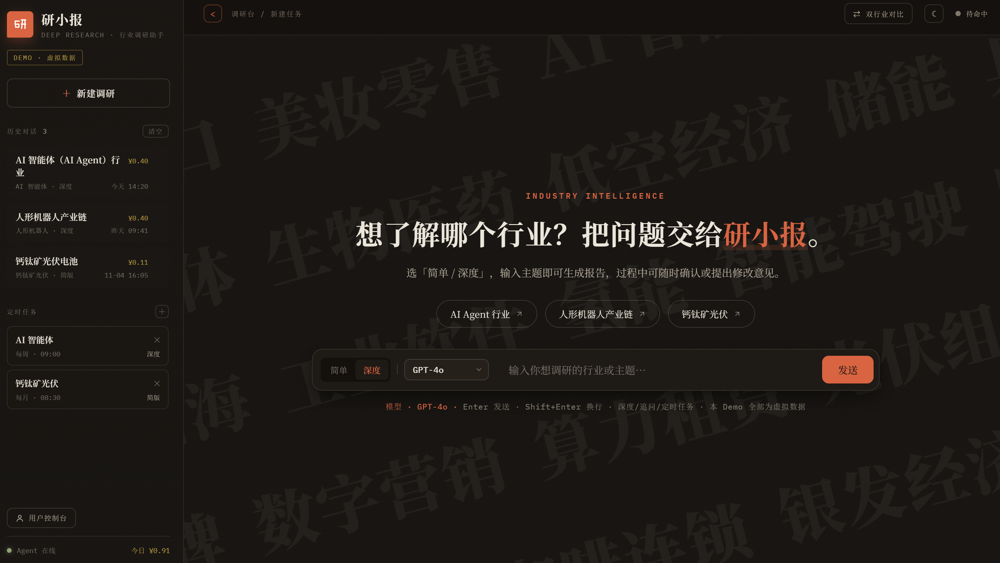
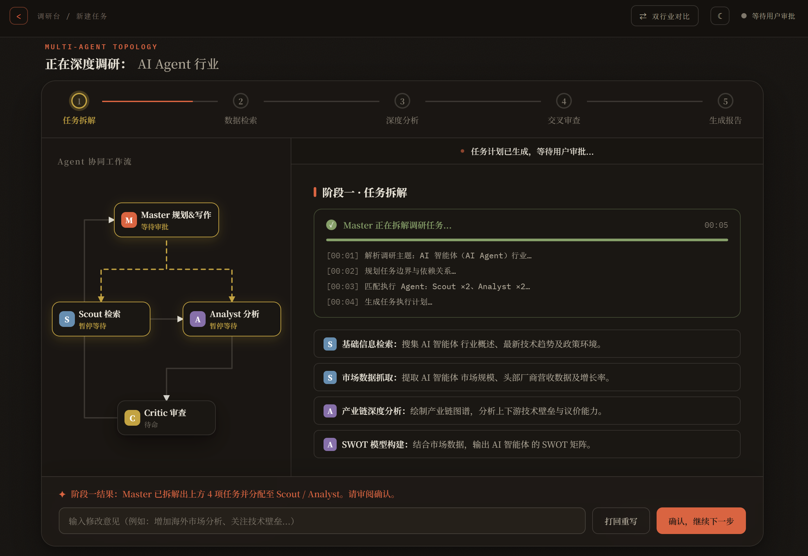
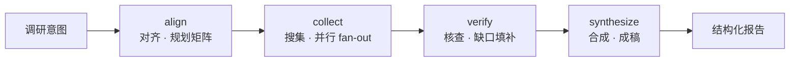

<div align="center">

<h1>
   研小报 · deep research
</h1>

**可验证溯源的行业调研多 Agent 助手**

把「搜一搜」升级为**可审计、可验证、信息密度高**的行业深度调研。

[](https://www.python.org/)
[](https://www.typescriptlang.org/)
[](https://vitejs.dev/)
[](https://fastapi.tiangolo.com/)
[](https://langchain-ai.github.io/langgraph/)
[](https://www.anthropic.com/)

<br/>


<!--  -->

</div>

---

## ✨ 这是什么

研小报是一个面向个人用户的**行业调研助手**：输入一个行业或主题，由多个 Agent 分工协作——规划、检索、分析、审查、合成——最终产出一份带**证据分级与内联引用溯源**的结构化深度报告。

它要解决的不是「聊得更长」，而是「查得更可信」：

- 每一句结论都能回溯到证据来源
- 每一步调研行为与成本都有账可查
- 报告信息密度高，而非堆砌废话

> 当前仓库同时包含 **Mock 演示前端**（零配置即可运行）与 **真实多 Agent 后端**（FastAPI + LangGraph）。

---

## 🎯 核心卖点

| 卖点 | 一句话 |
| --- | --- |
| **可审计** | 调研过程是可视化的多 Agent 流水线，每个阶段可归因 |
| **可验证** | 证据分级 + 内联引用，结论标注「实锤 / 推断 / 共识 / 分歧」 |
| **信息密度高** | 结构化组件：市场规模、产业链、竞争格局、SWOT、风险矩阵 |

---

## 🧠 设计理念

一条主线贯穿始终：

> **状态是事实，上下文是视图。** 状态可重放、可审计；上下文按角色编译。两者不混用，调研 Agent 才不会退化成「更长对话的聊天机器人」。

四个 Agent 角色，职责边界清晰：

| 角色 | 职责 | 校验边界 |
| --- | --- | --- |
| **Lead** 规划者 | 生成研究矩阵、拆解子任务、监控进度 | 查什么、查全没 |
| **Collector** 搜集 | 采集信息、抽取结构化结论、更新证据台账 | 有没有、哪来的 |
| **Verifier** 核查 | 证据可信度分级、交叉验证、标注证据强度 | 证据可不可信 |
| **Synthesizer** 合成 | 聚合去重、一致性校验、产出报告 | 结论矛不矛盾 |

四个执行阶段：



---

## 🏗️ 七模块架构

后端按七个边界清晰的模块组织：

| 模块 | 一句话定义 |
| --- | --- |
| **State** 状态 | 单一事实源，调研任务的运行时图状态（含检查点，支持断点续跑） |
| **Orchestration** 调度 | 状态图上的节点派发（阶段感知 + 依赖感知） |
| **Context** 上下文 | 从状态按角色编译出来的「当前视图」 |
| **Memory** 记忆 | 状态的跨会话投影，跨任务沉淀知识 |
| **Skill** 技能 | 上下文的受控注入，教 Agent 组合已有能力 |
| **Tool** 工具 | 原子能力注册表（可接 MCP） |
| **Security** 安全 | 横切在所有状态写入与上下文编译的边界上 |

---

## 🚀 快速开始

### 前端 Mock 演示（零配置，推荐先跑这个）

前端是纯静态的演示，内置虚拟数据，**无需任何 API Key**：

```bash
npm install
npm run dev
```

浏览器打开 Vite 提示的地址（默认 `http://localhost:5173`），即可体验：

- 多 Agent 协同 DAG（拓扑图 + 流式执行卡片 + 阶段审批）
- 深度调研（五阶段）/ 简单调研（三阶段）
- 双行业对比、定时任务
- 用户控制台（调研行为与成本台账）
- 追问、深浅色主题、历史对话持久化

### 后端（真实多 Agent 实现）

Python 3.11+，推荐用 `uv`（自动按 `pyproject.toml` 准备依赖）：

```bash
uv run python backend/serve.py
```

启动后监听 `http://127.0.0.1:8000`，交互式文档在 `/docs`，`CTRL+C` 停止。已内置 CORS 白名单，前端 Vite（`localhost:5173`）可直接跨域调用。

**两种模式自动切换**（`serve.py` 读 `.env`）：

| 条件 | 模式 | 说明 |
| --- | --- | --- |
| 有 `.env` 且含 `API_KEY` | 真实 LLM | `AnthropicClient`，端点/模型由 `BASE_URL` / `MODEL_ID` 指定 |
| 无 `.env` 或无 `API_KEY` | 离线 Mock | `OfflineMockLLM`，零网络、零密钥，适合前端联调 |

`.env` 配置项：`API_KEY`、`BASE_URL`、`MODEL_ID`、`EMBEDDING_*`、`RERANKER_*`、`DB_PATH`（密钥只从环境变量读取，不进仓库）。

联调自检（用真实配置分步验证 LLM 结构化输出、Embedding、完整调研链路）：

```bash
python backend/live_check.py
```

接口清单与对接路线见 [`docs/api-integration.md`](docs/api-integration.md)，配置与部署见 [`docs/operations.md`](docs/operations.md)。

---

## 📁 目录结构

```
research-agent/
├── frontend/              # Vite + TypeScript Mock 演示前端（含 index.html 入口）
│
├── backend/               # Python FastAPI + LangGraph 后端
│   ├── serve.py           # 启动入口（真实 LLM / 离线 Mock 自动切换）
│   ├── live_check.py      # 联调自检脚本
│   └── app/
│       ├── agents/        # 多 Agent（Lead / Collector / Verifier / Synthesizer）
│       ├── orchestration/ # 调度（阶段感知 + 依赖感知）
│       ├── state/         # 状态（单一事实源 + 检查点）
│       ├── context/       # 上下文编译
│       ├── memory/        # 记忆（跨会话投影）
│       ├── skill/         # 技能（受控注入）
│       ├── tools/         # 工具（原子能力）
│       ├── security/      # 安全（横切）
│       ├── observability/ # 可观测性
│       ├── llm/           # LLM 封装（Anthropic Claude）
│       └── api/           # 路由（HTTP + SSE）
│
├── docs/                  # 设计文档（架构 / 状态 / 调度 / 可观测性 / 评估 …）
├── test/                  # 后端测试（pytest）
├── agent-core.md          # 核心设计（可执行最小主线）
└── agent-extended.md      # 扩展设计（记忆 / 技能 / 安全 / 自进化）
```

---

## 📚 文档导航

| 文档 | 内容 |
| --- | --- |
| [`agent-core.md`](agent-core.md) | 核心设计 ToC：State + Orchestration 主线 |
| [`agent-extended.md`](agent-extended.md) | 扩展设计：Context / Memory / Skill / Tool / Security |
| [`docs/architecture.md`](docs/architecture.md) | 总体架构 |
| [`docs/state.md`](docs/state.md) | 状态与检查点 |
| [`docs/orchestration.md`](docs/orchestration.md) | 多 Agent 调度 |
| [`docs/observability.md`](docs/observability.md) | 可观测性 |
| [`docs/eval.md`](docs/eval.md) | 质量评估方案 |
| [`docs/operations.md`](docs/operations.md) | 部署与运维 |
| [`docs/api-integration.md`](docs/api-integration.md) | 前后端接口对接蓝图（端点清单 / 对照 / 路线） |

---

## 🧪 测试

```bash
# 全量（uv 自动准备依赖）
uv run pytest test -q

# 只跑离线端到端测试
uv run pytest test/test_offline_e2e.py -q
```

后端 LLM 层通过 `LLMClient` 协议抽象，测试时注入 Mock，**无需真实 API Key**。

离线 E2E（`test/test_offline_e2e.py`）覆盖简单调研全流程、深度调研 HITL 审批（confirm / retry）、SSE 阶段事件、模拟等待时间与中间态轮询、追问、幂等与参数校验。共享离线 Mock 在 `backend/app/llm/mock.py`：

- 设置 `MOCK_DELAY_MS=200` 可让每次 LLM 调用前等待 200ms，本地联调时能真实看到阶段推进动画，例如 `MOCK_DELAY_MS=200 uv run python backend/serve.py`。
- 不设则延迟为 0，测试与演示都瞬时完成。

### 前后端同时启动

两个终端分别运行：

```bash
uv run python backend/serve.py   # 终端 A：后端 8000
npm run dev                       # 终端 B：前端 5173
```

---

<div align="center">

<sub>研小报 · deep research —— 让每一次调研，皆有据可查。</sub>

</div>
